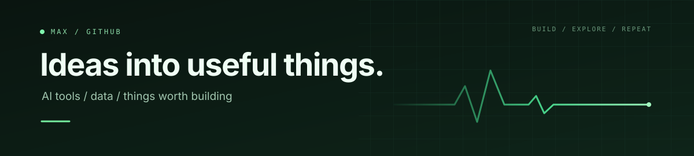

I build tools with AI coding agents. Most start with something I want to do in my own work. For Switchboard, I wanted to send a prompt, move to another project while the agent worked, and come back knowing which decision needed me next. I set the product direction and use Codex and Claude to help implement and test it.

### Switchboard

A local workspace for people running several Codex or Claude projects at once. With Send & move on enabled, sending a prompt moves you to the next ready chat. Each project keeps its goal, decisions, and next action. The built-in demo lets you try the workflow with three sample projects. [See the demo screen](https://github.com/malhadeff28-gif/switchboard/blob/main/docs/demo.png) · [Run Switchboard](https://github.com/malhadeff28-gif/switchboard#run)

### Notion Agent Connector

An agent searching a Notion workspace needs to show where its answer came from. This connector returns cited passages and checks the source pages again before handing them back. In a recorded live check, it retrieved three passages from two pages in one workspace. [Read the verification record](https://github.com/malhadeff28-gif/notion-agent-connector/blob/main/verification.json) · [Explore the connector](https://github.com/malhadeff28-gif/notion-agent-connector)

### YourTube

An early local prototype for finding videos about whatever I'm working on. When enabled, it takes a new Codex chat message, derives a general search phrase, and adds videos to a project feed. The public version starts paused. [See how it works](https://github.com/malhadeff28-gif/yourtube#how-it-works) · [Read the prototype checks](https://github.com/malhadeff28-gif/yourtube/blob/main/TESTING.md)

### Fantasy Football Lab

Is a second quarterback worth the draft pick? An eight-season backtest initially made a backup look valuable. When both strategies used the same starter, the backup cost an estimated 10.6 points per season after accounting for the pick. [See the seven comparisons](https://github.com/malhadeff28-gif/fantasy-football/blob/main/qb-pairing/research/QB_PAIRING_RESEARCH.md#12-bench-slot-opportunity-cost) · [Explore the research](https://github.com/malhadeff28-gif/fantasy-football)
