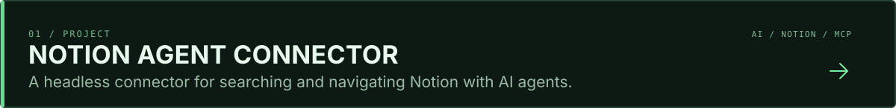
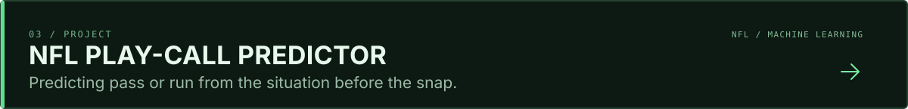
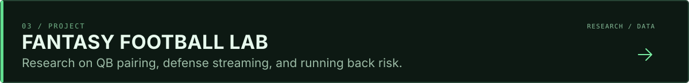
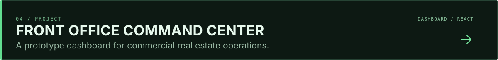
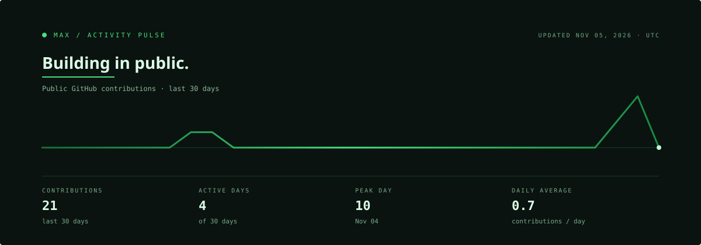

  

### Selected projects

### Activity pulse

  

Activity card inspired by <a href="https://github.com/beydemirfurkan/awesome-github-profile">Awesome GitHub Profile</a>. Counts reflect the public GitHub contributions graph and refresh daily.

### Exploring

[Switchboard](https://github.com/malhadeff28-gif/switchboard-community) · Fork of a desktop app for organizing Codex and Claude Code sessions.  
[UI/UX Pro Max](https://github.com/malhadeff28-gif/ui-ux-pro-max-skill) · Fork of a design intelligence toolkit.
